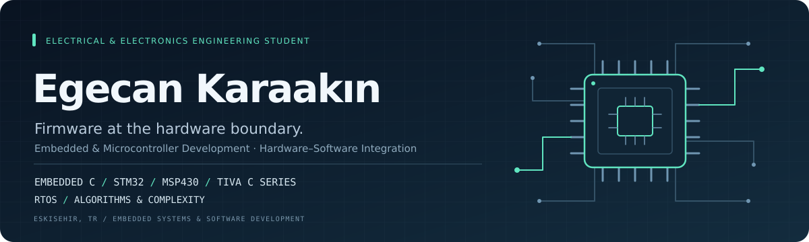

  

  <strong>Electrical & Electronics Engineering · Eskişehir Technical University</strong> 
  Embedded &amp; Microcontroller Development · Real-Time Systems · Eskişehir, Türkiye

  <a href="https://www.linkedin.com/in/egecankaraakin"><strong>LinkedIn ↗</strong></a>
  &nbsp; · &nbsp;
  <a href="mailto:egecan1633@gmail.com"><strong>Email ↗</strong></a>

---

### Firmware. Real-time systems. Hardware that responds.

I'm an Electrical and Electronics Engineering student focused on **embedded systems and firmware development**. As a former member of **IEEE ESTU Earendil Rover Team**, I worked on custom motor-control electronics and firmware connecting microcontrollers, sensors and power stages. My interests include **real-time systems, microcontroller development and industrial automation**.

I enjoy working at the hardware–software boundary: reading datasheets, bringing up boards, testing control logic and tracing unexpected behavior across the system.

**Currently studying:** Embedded System Design and Algorithms and Complexity.

### Engineering work

<table>
<tr>
<td width="50%" valign="top">

#### 01 / Rover motor controller
**Embedded C · STM32F411 / F446 · UART**

Custom BLDC controller development for the **Earendil Rover Team**.

- Hall-sensor-based six-step commutation and PWM control.
- Integration of gate drivers, a MOSFET power stage and current-sensing circuitry.
- Initial motor tests and investigation of switching sequences and sensor feedback.
- UART communication between a master controller and motor-driver boards.

**My contribution:** Firmware implementation, initial motor tests and communication debugging during my time on the team.

</td>
<td width="50%" valign="top">

#### 02 / Algorithmic audio reverb
**Python · DSP · Algorithm implementation**

A Schroeder-style reverberation implementation built around modular signal-processing stages.

- Parallel damped feedback comb filters.
- Cascaded all-pass filters and wet/dry mixing.
- Stability and decay evaluation with test signals and audio experiments.

**Focus:** Implementation, modularity and testing.

</td>
</tr>
</table>

### Current learning focus

- **Embedded System Design:** studying embedded-system development, building on my previous hands-on rover experience.
- **Real-time firmware:** TI-RTOS / SYS/BIOS, hardware and software interrupts, timers and interrupt priorities.
- **Low-level programming:** MSP430 assembly and microcontroller peripherals.
- **Algorithms and Complexity:** strengthening Java/OOP and data-structure fundamentals.

### Technical toolkit

| Area | Technologies & practices |
| :--- | :--- |
| **Firmware & programming** | Embedded C · MSP430 assembly · Python · Java / OOP fundamentals |
| **Embedded systems** | STM32 · GD32 · TI Tiva C · MSP430 · TI-RTOS / SYS/BIOS |
| **Interfaces & control** | UART · PWM · GPIO · Timers · Interrupts · Hall-sensor feedback |
| **Development & hardware** | Git · VS Code · STM32CubeIDE · Code Composer Studio · Apache NetBeans · KiCad · OpenCode |
| **AI-supported development** | Agentic workflows · AI-assisted development · Iterative debugging |

### Beyond implementation

- **IEEE ESTU Earendil Rover Team (former member):** component and reference-design research; team representation at SAHA EXPO.
- **IEEE ESTU Student Branch | Communications Society:** former Committee Vice Chair; technical events, speaker outreach and coordination.
- **Erasmus+:** exchange experience at Częstochowa University of Technology, Poland.
- **Technical research:** English-language documentation, datasheets and application notes.

---

  <strong>Interested in embedded systems, firmware and real-time systems opportunities.</strong> 
  <a href="mailto:egecan1633@gmail.com">Let's connect.</a>

